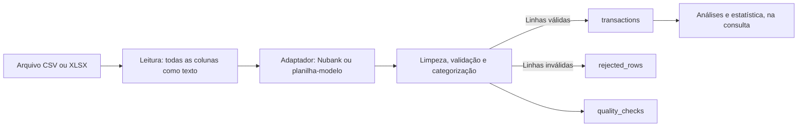

# Análise de dados no gerenCIA

O gerenCIA é, antes de tudo, um projeto de análise de dados. Ele recebe arquivos
financeiros brutos, trata e valida cada linha e produz medidas que descrevem os
gastos da pessoa. Este documento explica os três eixos de análise do projeto e
mostra onde cada um é aplicado. Os requisitos detalhados estão no
[planejamento](planejamento-gerencia.txt).

| Eixo | Pergunta que responde | Etapas |
|---|---|---|
| [Transformação dos dados](#1-transformação-dos-dados) | Como um arquivo bruto vira dado confiável? | 3 |
| [Limpeza e qualidade de dados](#2-limpeza-e-qualidade-de-dados) | Quanto do dado pode ser usado, e por quê? | 3 |
| [Estatística descritiva](#3-estatística-descritiva) | O que os gastos mostram? | 4, apresentada na 5 e explicada pela IA na 7 |

Todo o tratamento e todos os cálculos são feitos em Python, com pandas, no
backend. O frontend só apresenta os resultados.

A primeira versão não usa camadas de engenharia de dados, como a arquitetura
Medallion. O foco está na transformação, na qualidade e na análise: o arquivo
é lido, limpo e gravado diretamente como transações, e as análises são
calculadas a partir delas.

## 1 Transformação dos dados

Transformar é levar o arquivo do banco ao formato padronizado que as análises
usam. O processo acontece em memória, com pandas, durante o envio do arquivo.



| Passo | O que faz | Resultado |
|---|---|---|
| Leitura | `read_csv` ou `read_excel` com `dtype=str`, detectando codificação e delimitador | O texto exatamente como veio no arquivo |
| Adaptação | Reconhece o formato pelas colunas e as renomeia para os campos internos | Colunas de data, descrição, valor e as opcionais |
| Limpeza e validação | Converte datas e valores, padroniza textos, identifica tipo e estabelecimento | Cada linha vira uma transação ou uma rejeição |
| Categorização | Aplica a ordem de decisão da seção 7 do planejamento | Categoria e origem da categoria |
| Gravação | Grava transações, rejeições e relatório numa única transação do banco | Ou o arquivo entra inteiro, ou nada entra |

Princípios do tratamento:

- **Funções testáveis.** Cada passo é uma função que recebe e devolve dados
  simples, sem depender do FastAPI nem do banco. Por isso cada uma tem testes
  unitários com pytest.
- **Rastreabilidade.** Cada transação e cada rejeição guarda `upload_id` e
  `source_row`. Qualquer número do dashboard pode ser seguido até a linha do
  arquivo que o originou.
- **Sem duplicação.** O reenvio do mesmo arquivo é reconhecido pelo hash, e a
  mesma transação em extratos sobrepostos, pelo identificador bancário.
- **Nenhuma linha some.** As reconciliações da seção 2.3 provam que todas as
  linhas recebidas foram contabilizadas.

A leitura usa `dtype=str` em todas as colunas. Sem isso, o pandas tentaria
adivinhar os tipos e poderia, por exemplo, transformar `"1.234"` (mil duzentos
e trinta e quatro reais) em `1.234` (um vírgula dois), alterando o dado antes
do tratamento.

### Uma linha do começo ao fim

Exemplo ilustrativo, com dados fictícios, no formato da planilha-modelo:

```text
Data;Descrição;Valor
15/06/2026;Compra no débito - IFD*IFOOD  ;-58,70
31/02/2026;Pix enviado - Padaria Estrela;-12,00
```

| Passo | Linha 2 do arquivo | Linha 3 do arquivo |
|---|---|---|
| Leitura | `{"Data": "15/06/2026", "Descrição": "Compra no débito - IFD*IFOOD  ", "Valor": "-58,70"}` | `{"Data": "31/02/2026", "Descrição": "Pix enviado - Padaria Estrela", "Valor": "-12,00"}` |
| Limpeza | Gravada em `transactions`: data `2026-06-15`, estabelecimento `iFood`, valor `58.70`, tipo `purchase`, categoria Alimentação | Rejeitada em `rejected_rows`: código `invalid_date`, "A data 31/02/2026 não existe." |
| Análises | Entra no total de Alimentação de junho de 2026 e nas medidas da categoria | Não entra; aparece no relatório de qualidade |

O relatório de qualidade desse arquivo registra 2 linhas, 1 válida e 1
rejeitada.

## 2 Limpeza e qualidade de dados

### 2.1 Problemas que a limpeza resolve

| Problema | Exemplo | Tratamento |
|---|---|---|
| Codificação de caracteres | `Descrição` lido como `Descrição` | Detectar a codificação (UTF-8 ou Latin-1) antes de ler |
| Separador de colunas | `;` em um arquivo, `,` em outro | Detectar o delimitador do CSV |
| Número no formato brasileiro | `1.234,56` | Converter para `Decimal("1234.56")`, como no [guia de conversão de valores](guia-conversao-valores.md) |
| Datas em formatos diferentes | `15/06/2026` no CSV, `46188` no Excel | Converter os dois para a mesma data, `2026-06-15` |
| Espaços e maiúsculas | `"  ifood "` | Remover espaços extras e padronizar a caixa |
| Prefixos de maquininha | `IFD*IFOOD`, `99APP *CORRIDA` | Regras de estabelecimento: `iFood`, `99` |
| Linhas que não são transações | `Saldo anterior`, `Total` | Rejeitar com motivo, nunca descartar em silêncio |
| Campos vazios | Valor em branco | Rejeitar a linha; nunca transformar em zero |
| Registros repetidos | Mesma transação em extratos sobrepostos | Identificador bancário |
| Sinais diferentes entre origens | Saída negativa no extrato, compra positiva na fatura | Guardar o valor absoluto e o sentido em `transaction_type` |

**Dados ausentes não são preenchidos.** Em dados financeiros, estimar um valor
ausente ou trocá-lo por zero mudaria os totais sem que a pessoa soubesse. A
linha é rejeitada, com motivo, e aparece no relatório de qualidade para
conferência.

### 2.2 Dimensões de qualidade

Cada processamento mede quatro dimensões e as registra em `quality_checks`.

| Dimensão | Pergunta | Como é medida |
|---|---|---|
| Completude | Os campos obrigatórios estão preenchidos? | Percentual de linhas com data, descrição e valor |
| Validade | Os valores têm formato e conteúdo aceitáveis? | Percentual de datas existentes e valores convertidos com sucesso |
| Unicidade | Há registros repetidos? | Quantidade de duplicatas pelo identificador bancário |
| Consistência | Os totais fecham? | Reconciliações da seção 2.3 |

O **percentual de qualidade** de um arquivo é a proporção de linhas válidas:

```text
percentual de qualidade = linhas válidas ÷ total de linhas × 100
```

Um extrato com 200 linhas, das quais 194 são válidas, tem 97% de qualidade.
O relatório mostra também o resultado de cada dimensão e permite baixar as
linhas rejeitadas com seus motivos.

### 2.3 Reconciliações

```text
total de linhas            = linhas válidas + linhas rejeitadas
soma das categorias        = gasto total do arquivo
saldo inicial + movimentos = saldo final (quando o extrato traz saldo)
```

As duas primeiras são verificadas em todo processamento, e a terceira quando o
extrato traz saldo. O banco já recusa um registro de qualidade em que a
primeira não feche. Uma reconciliação que falhe cancela a gravação do arquivo
inteiro, em vez de publicar números errados.

## 3 Estatística descritiva

A estatística descritiva resume um conjunto de valores em poucas medidas. No
gerenCIA, o conjunto é formado pelas despesas de um período: compras e
tarifas. Estornos, entradas, pagamentos de fatura e duplicatas ficam fora das
medidas. Os totais continuam líquidos (compras e tarifas menos estornos), os
mesmos usados nos limites por categoria.

As medidas são calculadas no momento da consulta, a partir de `transactions`,
para cada mês, para o período inteiro e para cada categoria.

| Grupo | Medida | O que mostra | Em pandas |
|---|---|---|---|
| Tendência central | Média | Gasto médio por compra | `mean()` |
| | Mediana | Valor da compra típica, sem a distorção das compras grandes | `median()` |
| | Moda | Categoria e estabelecimento mais frequentes | `value_counts()` |
| Dispersão | Mínimo, máximo e amplitude | A menor e a maior compra e a distância entre elas | `min()`, `max()` |
| | Desvio padrão | Quanto as compras variam em torno da média | `std(ddof=0)` |
| | Quartis e intervalo interquartil | Os limites dos 25%, 50% e 75% das compras e a faixa central | `quantile([0.25, 0.5, 0.75])` |
| Distribuição | Frequência por faixa de valor | Quantas compras caem em cada faixa, no histograma | `cut()` com `value_counts()` |
| Frequência | Contagem e participação por categoria e estabelecimento | Onde a pessoa gasta mais e com mais frequência | `groupby()` com `agg()` |

### Decisões de cálculo

- **Média e mediana aparecem juntas.** Gastos são assimétricos: poucas compras
  grandes puxam a média para cima. Nas compras de R$ 10, R$ 12, R$ 15, R$ 18 e
  R$ 300, a média é R$ 71,00, mas a compra típica, a mediana, é R$ 15,00.
- **Desvio padrão populacional.** As despesas do mês são todos os dados do
  período, não uma amostra. Por isso o cálculo usa `ddof=0`. O padrão do
  pandas é `ddof=1` (amostral), então o parâmetro fica explícito no código.
- **Quartis** usam o método padrão do pandas (interpolação linear). O método
  fica registrado no código e nos testes.
- **Precisão.** Somas, totais, limites e reconciliações usam `Decimal`. Desvio
  padrão e quartis são calculados em ponto flutuante e arredondados para
  centavos, porque são medidas descritivas e não entram em reconciliação.
- **Dados insuficientes.** Com menos de 4 despesas no grupo, desvio padrão e
  quartis aparecem como "dados insuficientes" em vez de um número enganoso.

### Onde as medidas aparecem

- Cards de gasto total, gasto médio, mediana e maior despesa.
- Histograma da distribuição dos valores das compras.
- Tabela por categoria com quantidade, total, participação, média, mediana,
  mínimo e máximo.
- Ranking de estabelecimentos por frequência e por valor.
- Resumo enviado ao diagnóstico do mês, em que a IA explica as medidas em
  linguagem simples. A IA não calcula: os números vêm das funções acima.

As medidas são conferidas por testes com conjuntos pequenos, cujos resultados
são calculados à mão, como o exemplo da média e da mediana acima.

## 4 Onde cada conceito é aplicado

| Conceito | Etapa | Código | Tabelas | Como é verificado |
|---|---|---|---|---|
| Leitura e adaptação | 3 | `backend/app/pipeline/` | Nenhuma; acontece em memória | Testes unitários com arquivos de exemplo de cada formato |
| Limpeza e padronização | 3 | `backend/app/pipeline/` | `transactions`, `rejected_rows` | Testes unitários de conversão de valores, datas e textos |
| Qualidade de dados | 3 | `backend/app/pipeline/` | `quality_checks` | Dimensões calculadas e reconciliações automáticas |
| Estatística descritiva | 4 | `backend/app/pipeline/` | Calculada a partir de `transactions` | Testes com resultados calculados à mão |
| Apresentação | 5 | `frontend/src/` | Lidas pela API de analytics | Verificações da interface |
| Diagnóstico com IA | 7 | `backend/app/ai/` | `ai_insights` | Testes com um cliente falso |
