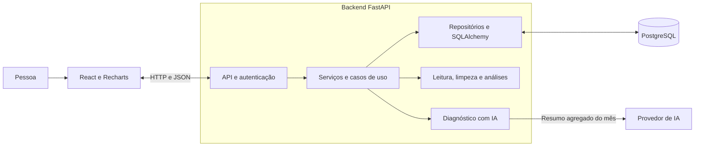
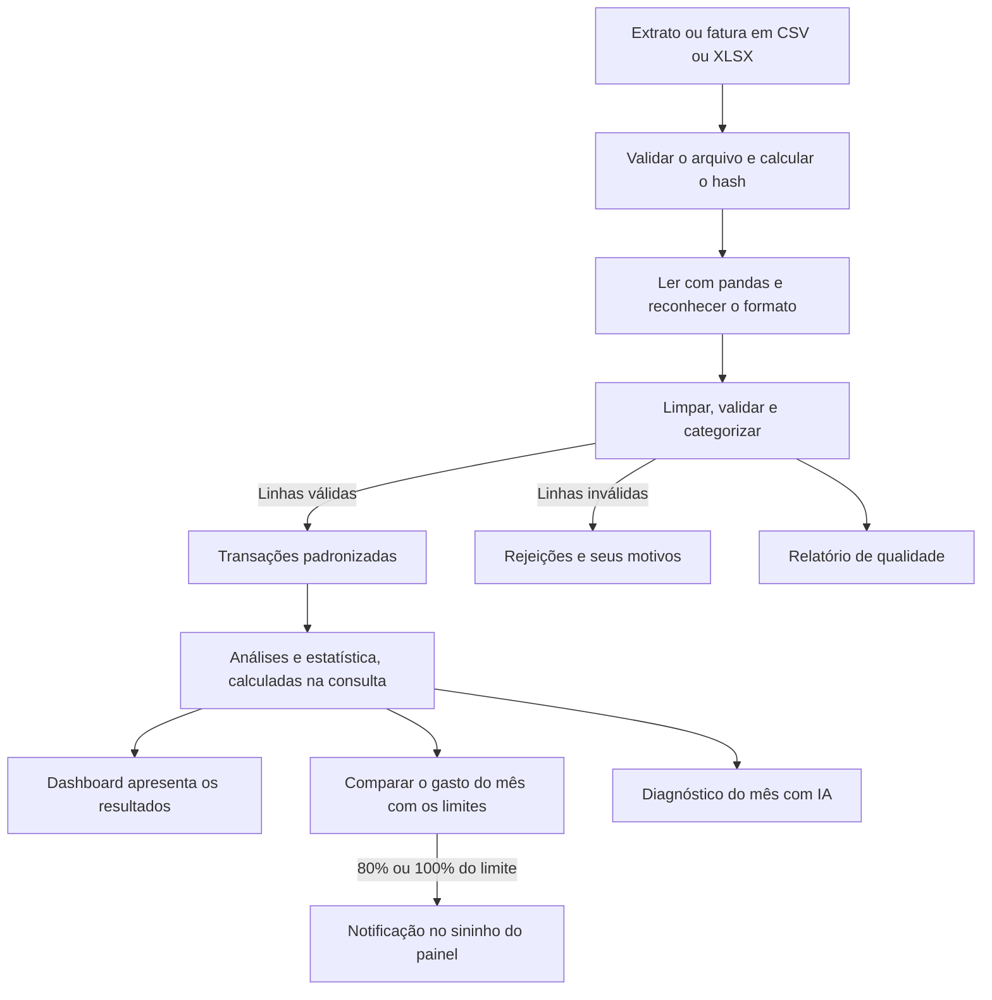

# Arquitetura do gerenCIA

O gerenCIA transforma extratos bancários e faturas de cartão, em CSV e XLSX, em
análises financeiras pessoais e guarda o histórico de todos os arquivos enviados. Este
é o mapa rápido da arquitetura planejada. O [planejamento completo](planejamento-gerencia.txt)
define os requisitos; a tabela de estado ao final mostra o que já existe.

## Divisão de responsabilidades

O frontend apresenta os dados. O backend autentica o usuário, aplica as regras,
processa os arquivos e acessa o PostgreSQL. Os blocos dentro do backend são
módulos da mesma aplicação FastAPI, não serviços separados.

| Parte | Onde fica | Responsabilidade |
|---|---|---|
| Interface | `frontend/src/` | Páginas, formulários, filtros e gráficos |
| API e contratos | `backend/app/api/` e `schemas/` | Receber requisições, validar entradas e formatar respostas |
| Configuração e segurança | `backend/app/core/` | Configuração, sessões, segurança e erros compartilhados |
| Serviços | `backend/app/services/` | Coordenar os casos de uso e o usuário autorizado |
| Persistência | `backend/app/repositories/`, `models/` e `db/` | Consultas, modelos e conexão com PostgreSQL |
| Processamento | `backend/app/pipeline/` | Leitura, limpeza, categorização e cálculos das análises |
| IA | `backend/app/ai/` | Montar o resumo do mês, chamar o provedor e validar a resposta |
| Testes | `backend/tests/` e `scripts/frontend/` | Testes unitários e de integração com pytest; verificações da interface com Playwright |

Crie os módulos futuros quando houver funcionalidade para implementar. A direção
de dependência é `API → Serviços → Repositórios → Banco`. Serviços também
coordenam o pipeline e a IA; nenhum dos dois depende do FastAPI. Análises,
limites e notificações são implementados nos serviços e no pipeline conforme
necessário, sem adicionar outra aplicação.

## Caminho de um arquivo

Este diagrama representa os dados ao longo do processamento, não as dependências
entre arquivos Python. Os conceitos de análise de dados aplicados em cada passo
estão em [análise de dados](analise-de-dados.md). A API e os serviços coordenam o fluxo; os repositórios
persistem os registros.

O arquivo é processado durante a própria requisição de upload e gravado numa
única transação do banco: ou entram as transações, as rejeições e o relatório
de qualidade, ou nada entra. O arquivo original não é guardado. As análises são
calculadas na consulta, a partir das transações, sem tabelas de resultados
pré-calculados. A primeira versão não usa a arquitetura Medallion nem
processamento em segundo plano.

## Hospedagem

A versão da banca será publicada em planos gratuitos e usada pela turma e pela
banca. O frontend e a API ficam na mesma origem: em domínios diferentes, o
navegador não envia o cookie de sessão `SameSite=Lax` nas chamadas à API. A
primeira publicação acontece já na etapa de upload, para que problemas de
hospedagem apareçam cedo. A chave do provedor de IA fica nas variáveis de
ambiente da hospedagem, nunca no frontend.

## Regras para manter o projeto organizado

- Rotas HTTP delegam os casos de uso aos serviços; consultas ficam nos repositórios.
- Valores monetários usam `Decimal` no processamento e coluna numérica no banco.
- Toda operação financeira usa o usuário obtido da sessão. O frontend não escolhe
  o dono dos dados. Categorias globais são a exceção pública já implementada.
- O backend calcula as métricas reais; o frontend as apresenta. A demonstração
  pública pode calcular exemplos fictícios em `demoModel.ts`, sem dados pessoais.
- PostgreSQL é a única persistência; o arquivo original não é guardado. Redis,
  Celery, Kafka e outros serviços continuam fora da primeira versão.
- A IA recebe somente o resumo agregado do mês e explica as análises; os
  cálculos continuam no backend.
- Toda função de leitura, limpeza, análise e regra de negócio tem testes
  unitários com pytest, entregues no mesmo pull request.
- Cada etapa tem uma branch própria, mesclada na `main` por pull request.
- Testes do banco usam um servidor PostgreSQL temporário separado do banco de
  desenvolvimento. Produção será configurada na implantação.
- Mantenha os testes de interface em `scripts/frontend/`. Capturas geradas vão
  para `.impeccable/review/`, ignorada pelo Git.
- Ao substituir um arquivo, atualize imports, testes e documentação e retire a
  versão obsoleta. Dependências, caches e builds locais ficam fora do Git.

## Estado atual e próximos ajustes

| Parte | Estado atual |
|---|---|
| PostgreSQL e SQLAlchemy | Conexão funcionando, 10 tabelas mapeadas e 11 categorias globais ativas |
| API | Saúde da aplicação, saúde do banco, consulta de categorias e autenticação (`/api/auth/register`, `login`, `logout` e `me`) |
| Frontend | Demonstração fictícia para visitantes; cadastro e login reais, com sessão por cookie; painel em `/app` com barra lateral, próximos passos e dados da conta |
| Testes do banco | Suíte de integridade e códigos numéricos; 97 casos aprovados na revisão |
| Camadas do backend | Autenticação usa serviço e repositórios; a rota de categorias usa o repositório `repositories/categories.py`, sem serviço, porque ainda não tem regra de negócio |
| Funcionalidades financeiras | Upload e histórico, leitura e limpeza, análises, limites, notificações e diagnóstico com IA ainda pendentes |
| Hospedagem | Ainda não publicada; prevista em plano gratuito a partir da etapa de upload |
| Fora da primeira versão | Conversa com a IA, previsão de cobranças com calendário, mapeador genérico, arquivo original guardado, e-mails pelo Resend e limite semanal (seção 18 do planejamento) |
| Ferramentas previstas | Alembic e Docker Compose ainda pendentes; limite de tentativas de login ainda pendente |

O próximo passo da fundação é concluir Alembic e Docker Compose. Funções
independentes de tratamento, como a conversão monetária, podem ser estudadas e
testadas em paralelo, sem depender do banco.

O esquema atual ainda tem peças do desenho anterior: a tabela `bronze_rows`, a
coluna `transactions.bronze_row_id`, a tabela `upload_mappings` e as colunas
`storage_path` e `status` de `uploads`. Elas saem por migração Alembic na
etapa 2. O esquema também ainda não distingue extrato de fatura em `uploads`,
não aceita o tipo `income` em `transactions` e não tem as tabelas
`category_budgets`, `notifications` e `ai_insights`, que entram nas etapas 2,
3, 6 e 7.

As atualizações existentes estão em `scripts/migrations/` e são SQL manuais;
a adoção de Alembic deverá preservar esse histórico e os dados existentes.

## Documentos de apoio

- [Análise de dados](analise-de-dados.md): transformação, limpeza e qualidade, estatística descritiva.
- [Planejamento completo](planejamento-gerencia.txt): requisitos, etapas e critérios de aceite.
- [Configuração do banco](database-setup.md): instalação, atualizações e testes isolados.
- [Guia de conversão de valores](guia-conversao-valores.md): primeira atividade de programação acompanhada.
- [Verificações do frontend](../scripts/frontend/README.md): preparação das ferramentas e comandos atuais.
