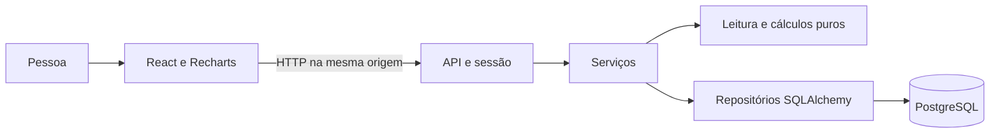

# Arquitetura do gerenCIA

Uma aplicação React e uma API FastAPI transformam arquivos financeiros em análises
pessoais. PostgreSQL é a única persistência. A implementação continua adequada a
um projeto acadêmico: processamento na requisição, sem filas, cache externo ou IA.

## Responsabilidades

| Camada | Local e responsabilidade |
| --- | --- |
| Interface | `frontend/src/`: páginas, formulários, filtros e gráficos |
| Transporte | `frontend/src/lib/api.ts`: erros e requisições; `panel/api.ts`: contratos financeiros |
| HTTP | `backend/app/api/` e `schemas/`: sessão, validação, respostas |
| Casos de uso | `services/`: autorização, transações, limites e avisos |
| Persistência | `repositories/`, `models/`, `db/`: consultas sempre limitadas pelo usuário |
| Processamento | `pipeline/`: leitura, limpeza, categorias, duplicatas e estatística |
| Evolução | `backend/migrations/`: revisões Alembic e preservação de metadados legados |
| Verificação | `backend/tests/` e `scripts/frontend/`: testes puros, PostgreSQL temporário e Playwright |

## Caminho do arquivo

O envio valida formato e tamanho (4 MB), lê com pandas, padroniza datas/valores,
aplica categorias e confere identificadores bancários. Transações, rejeições e
qualidade são gravadas atomicamente. O original não é guardado. O histórico mantém
linha/folha de origem e metadados comprováveis. Conteúdo repetido reaproveita o envio.

As análises consultam todas as transações elegíveis do usuário. Compras e tarifas
somam gasto; estornos reduzem; receitas e pagamentos ficam separados. Duplicatas
confirmadas saem do total, suspeitas continuam contadas. Ao remover um arquivo,
uma cópia restante pode se tornar canônica na mesma transação.

`pipeline/analytics.py` compartilha os cálculos entre as rotas de análise e a
fachada de compatibilidade. Estatísticas e deduplicação têm módulos próprios;
`analise.py` coordena o processamento. A lista paginada aplica os mesmos filtros
aos agregados completos, antes de limitar a página.

## Interface interna

O shell autenticado contém Painel, Arquivos, Transações, Limites e Conta. As cores
petróleo/menta permanecem; categorias ganham cor e ícone próprios. Distribuição do
gasto ocupa o centro do Painel, comparação fica ao lado e detalhes abaixo. Serviços
recorrentes usam histórico observado, sem previsão de cobranças.

Os estilos internos são carregados com a página do painel, isolados do site público.
Transporte HTTP e formatação são compartilhados. A demonstração pública continua
fictícia e independente de conta ou arquivos pessoais.

## Banco e operação

Revisões `0002` e `0003` acrescentam metadados financeiros, receitas, limites e
avisos. `0004` retira estruturas legadas somente após preservar metadados em
qualidade; conteúdo bruto/mapeamento não vazio sem conversão validada interrompe
a operação. Revisões e SQL históricos permanecem intactos. Consulte o
[guia do banco](database-setup.md) antes de atualizar um banco existente.

O destino confirmado é a [Vercel](vercel.md). Rewrites mantêm frontend e API na
mesma origem para o cookie de sessão. PostgreSQL fica em serviço externo e suas
credenciais somente no backend. Publicação, migração no banco de uso e validação
hospedada precisam de evidência própria; testes locais não comprovam essas etapas.

## Documentos

- [Análise de dados](analise-de-dados.md): conceitos e semântica financeira.
- [Plano aprovado](superpowers/plans/2026-11-16-renovacao-interna-v1.md).
- [Escopo atualizado](superpowers/specs/2026-11-17-escopo-sem-ia.md): IA adiada e Vercel.
- [Verificações da interface](../scripts/frontend/README.md).
