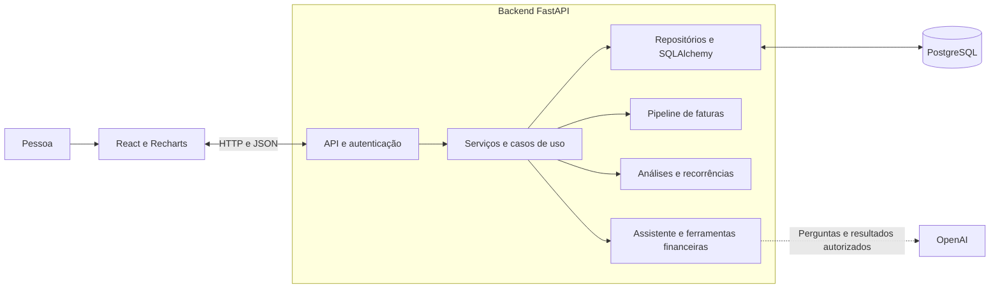
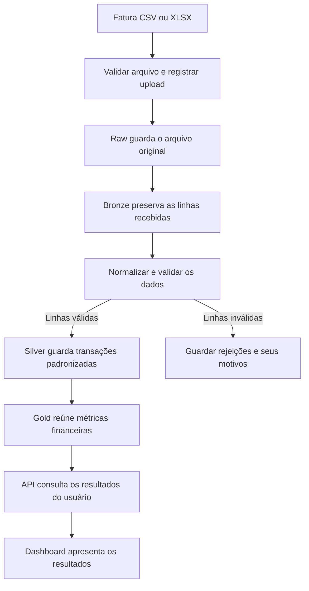

# Arquitetura do gerenCIA

O gerenCIA transforma faturas CSV e XLSX em análises financeiras pessoais. Este
é o mapa rápido da arquitetura planejada. O [planejamento completo](planejamento-gerencia.txt)
define os requisitos; a tabela de estado ao final mostra o que já existe.

## Divisão de responsabilidades

O frontend apresenta os dados. O backend autentica o usuário, aplica as regras,
processa os arquivos e acessa o PostgreSQL. Os blocos dentro do backend são
módulos da mesma aplicação FastAPI, não serviços separados.

| Parte | Onde fica | Responsabilidade |
|---|---|---|
| Interface | `frontend/src/` | Páginas, formulários, filtros e gráficos |
| API e contratos | `backend/app/api/` e `schemas/` | Receber requisições, validar entradas e formatar respostas |
| Configuração e segurança | `backend/app/core/` | Configuração, sessões, segurança e erros compartilhados |
| Serviços | `backend/app/services/` | Coordenar os casos de uso e o usuário autorizado |
| Persistência | `backend/app/repositories/`, `models/` e `db/` | Consultas, modelos e conexão com PostgreSQL |
| Processamento | `backend/app/pipeline/` | Leitura, normalização, validação e cálculos financeiros |
| IA | `backend/app/ai/` | Orquestrar perguntas e ferramentas financeiras controladas |
| Testes | `backend/tests/` e `scripts/frontend/` | Verificar regras, banco e interface |

Crie os módulos futuros quando houver funcionalidade para implementar. A direção
de dependência é `API → Serviços → Repositórios → Banco`. Serviços também
coordenam o pipeline e as ferramentas de IA; o pipeline não depende do FastAPI.
Análises e recorrências são implementadas nos serviços e no pipeline conforme
necessário, sem adicionar outra aplicação.

## Caminho de uma fatura

Este diagrama representa os dados ao longo do processamento, não as dependências
entre arquivos Python. A API e os serviços coordenam o fluxo; os repositórios
persistem os registros.

Raw guarda os arquivos no armazenamento local previsto no plano. Bronze, Silver,
Gold e os registros de qualidade ficam no PostgreSQL. Inicialmente, o backend
terá uma instância e usará `BackgroundTasks` para continuar o processamento após
responder ao upload, sem adicionar fila ou worker separado.

## Regras para manter o projeto organizado

- Rotas HTTP delegam os casos de uso aos serviços; consultas ficam nos repositórios.
- Valores monetários usam `Decimal` no processamento e coluna numérica no banco.
- Toda operação financeira usa o usuário obtido da sessão. O frontend não escolhe
  o dono dos dados. Categorias globais são a exceção pública já implementada.
- O backend calcula as métricas reais; o frontend as apresenta. A demonstração
  pública pode calcular exemplos fictícios em `demoModel.ts`, sem dados pessoais.
- A IA usa ferramentas controladas, que passam pelos serviços e repositórios.
  O modelo não executa SQL nem recebe o arquivo bruto.
- PostgreSQL é a única persistência estruturada. Redis, Celery, Kafka e outros
  serviços continuam fora da primeira versão.
- Testes do banco usam um servidor PostgreSQL temporário separado do banco de
  desenvolvimento. Produção será configurada na implantação.
- Mantenha os testes de interface em `scripts/frontend/`. Capturas geradas vão
  para `.impeccable/review/`, ignorada pelo Git.
- Ao substituir um arquivo, atualize imports, testes e documentação e retire a
  versão obsoleta. Dependências, caches e builds locais ficam fora do Git.

## Estado atual e próximos ajustes

| Parte | Estado atual |
|---|---|
| PostgreSQL e SQLAlchemy | Conexão funcionando, 10 tabelas mapeadas e 11 categorias globais ativas |
| API | Saúde da aplicação, saúde do banco, consulta de categorias e autenticação (`/api/auth/register`, `login`, `logout` e `me`) |
| Frontend | Demonstração fictícia; cadastro e login reais, com sessão por cookie |
| Testes do banco | Suíte de integridade e códigos numéricos; 97 casos aprovados na revisão |
| Camadas do backend | Autenticação já usa serviço e repositórios; a rota de categorias ainda consulta diretamente o banco |
| Funcionalidades financeiras | Upload, pipeline, Gold, recorrências e IA ainda pendentes |
| Ferramentas previstas | Alembic, Docker Compose, Vitest e Testing Library ainda pendentes; limite de tentativas de login ainda pendente |

Antes de ampliar os endpoints, adequar a consulta de categorias às camadas
previstas. Depois, concluir a fundação com Alembic, Docker Compose e Vitest.
Funções independentes de tratamento, como a conversão monetária, podem ser
estudadas e testadas em paralelo, sem depender do banco.

O esquema atual usa `upload_mappings` para o mapeamento de colunas dos uploads.
As atualizações existentes estão em `scripts/migrations/` e são SQL manuais;
a adoção de Alembic deverá preservar esse histórico e os dados existentes.

## Documentos de apoio

- [Planejamento completo](planejamento-gerencia.txt): requisitos, etapas e critérios de aceite.
- [Configuração do banco](database-setup.md): instalação, atualizações e testes isolados.
- [Guia de conversão de valores](guia-conversao-valores.md): primeira atividade de programação acompanhada.
- [Verificações do frontend](../scripts/frontend/README.md): preparação das ferramentas e comandos atuais.
