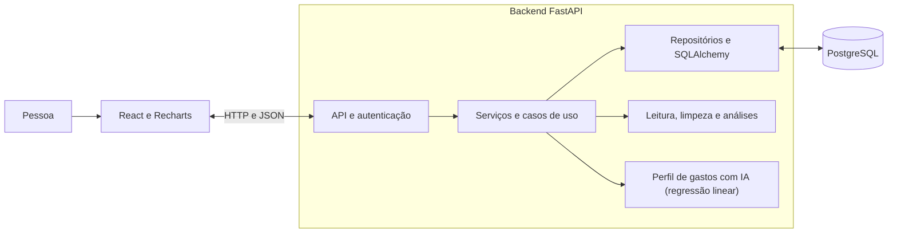
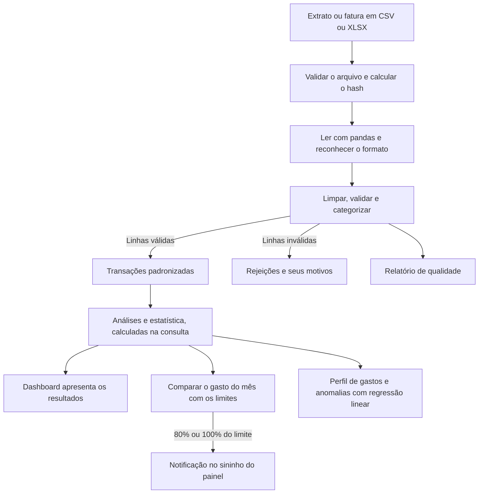

# Arquitetura do gerenCIA

O gerenCIA transforma extratos bancários e faturas de cartão, em CSV e XLSX, em
análises financeiras pessoais e guarda o histórico dos arquivos enviados. O
[planejamento completo](planejamento-gerencia.txt) define os requisitos. A
tabela de estado indica os componentes disponíveis e os planejados.

## Divisão de responsabilidades

O frontend apresenta os dados. O backend autentica o usuário, aplica as regras,
processa os arquivos e acessa o PostgreSQL. Os blocos dentro do backend são
módulos da mesma aplicação FastAPI, não serviços separados.

| Parte | Onde fica | Responsabilidade |
|---|---|---|
| Interface | `frontend/src/` | Páginas, formulários, filtros e gráficos |
| API e contratos | `backend/app/api/` e `schemas/` | Receber requisições, validar entradas e formatar respostas |
| Configuração e segurança | `backend/app/core/` | Configuração, sessões, segurança e erros compartilhados |
| Serviços | `backend/app/services/` | Coordenar os casos de uso e o usuário autorizado |
| Persistência | `backend/app/repositories/`, `models/` e `db/` | Consultas, modelos e conexão com PostgreSQL |
| Processamento | `backend/app/pipeline/` | Leitura, limpeza, categorização e cálculos das análises |
| IA | `backend/app/ai/` | Regressão linear própria (mínimos quadrados), perfil mensal e detecção de anomalias |
| Testes | `backend/tests/` e `scripts/frontend/` | Testes unitários e de integração com pytest; verificações da interface com Playwright |

Crie os módulos futuros quando houver funcionalidade para implementar. A direção
de dependência é `API → Serviços → Repositórios → Banco`. Serviços também
coordenam o pipeline e a IA; nenhum dos dois depende do FastAPI. Análises,
limites e notificações são implementados nos serviços e no pipeline conforme
necessário, sem adicionar outra aplicação.

## Caminho de um arquivo

Este diagrama representa os dados ao longo do processamento, não as dependências
entre arquivos Python. Os conceitos de análise de dados aplicados em cada passo
estão em [análise de dados](analise-de-dados.md). A API e os serviços coordenam o fluxo; os repositórios
persistem os registros.

O arquivo é processado durante a própria requisição de upload e gravado numa
única transação do banco: ou entram as transações, as rejeições e o relatório
de qualidade, ou nada entra. O arquivo original não é guardado. As análises são
calculadas na consulta, a partir das transações, sem tabelas de resultados
pré-calculados. A primeira versão não usa a arquitetura Medallion nem
processamento em segundo plano.

## Hospedagem

A versão da banca será publicada em planos gratuitos e usada pela turma e pela
banca. O frontend e a API ficam na mesma origem: em domínios diferentes, o
navegador não envia o cookie de sessão `SameSite=Lax` nas chamadas à API. A
primeira publicação acontece já na etapa de upload, para que problemas de
hospedagem apareçam cedo. A chave do provedor de IA fica nas variáveis de
ambiente da hospedagem, nunca no frontend.

## Regras para manter o projeto organizado

- Rotas HTTP delegam os casos de uso aos serviços; consultas ficam nos repositórios.
- O pipeline trabalha com valores inteiros em centavos. A gravação usa
  `Decimal` e colunas numéricas.
- Toda operação financeira usa o usuário obtido da sessão. O frontend não escolhe
  o dono dos dados. Categorias globais são a exceção pública já implementada.
- O backend calcula as métricas reais; o frontend as apresenta. A demonstração
  pública pode calcular exemplos fictícios em `demoModel.ts`, sem dados pessoais.
- PostgreSQL é a única persistência; o arquivo original não é guardado. Redis,
  Celery, Kafka e outros serviços continuam fora da primeira versão.
- A IA recebe somente o resumo agregado do mês e explica as análises; os
  cálculos continuam no backend.
- O projeto usa pytest para as regras de leitura, limpeza, análise e negócio.
  O [guia de testes](testes.md) indica o que está coberto e como executar.
- Cada etapa tem uma branch própria, mesclada na `main` por pull request.
- Testes do banco usam um servidor PostgreSQL temporário separado do banco de
  desenvolvimento. Produção será configurada na implantação.
- Mantenha os testes de interface em `scripts/frontend/`. Capturas geradas vão
  para `.impeccable/review/`, ignorada pelo Git.
- Ao substituir um arquivo, atualize imports, testes e documentação e retire a
  versão obsoleta. Dependências, caches e builds locais ficam fora do Git.

## Estado atual e próximos ajustes

| Parte | Estado atual |
|---|---|
| PostgreSQL e SQLAlchemy | Esquema inicial com 12 tabelas e 11 categorias globais. Banco e migrações estão em `scripts/` |
| API | Saúde, categorias, autenticação (com renda mensal), prévia local, arquivos, painel, transações, limites, notificações e perfil de gastos com IA |
| Frontend | Demonstração pública, cadastro e login, painel com dados da conta e renda, arquivos, transações, gráficos, limites e alertas de anomalia |
| Qualidade de software | Testes unitários, API, integração com PostgreSQL, servidor HTTP e navegador |
| Camadas do backend | Autenticação, upload e IA usam serviços e repositórios. Algumas consultas seguem nas rotas |
| Funcionalidades financeiras | Upload e histórico, leitura e limpeza, análises, limites, notificações e perfil de gastos com IA (regressão linear) implementados |
| Hospedagem | Configuração da Vercel em `vercel.json` |
| Fora da primeira versão | Conversa com a IA, previsão de cobranças com calendário, mapeador genérico, arquivo original guardado, e-mails pelo Resend e limite semanal (seção 18 do planejamento) |
| Ferramentas previstas | Alembic e Docker Compose ainda pendentes; limite de tentativas de login ainda pendente |

As atualizações versionadas estão em `scripts/migrations/`. Os limites por
mês e as notificações usam as tabelas `category_budgets` e `notifications`.
O esquema preserva tabelas legadas como `bronze_rows` e `upload_mappings`.

## Documentos de apoio

- [Análise de dados](analise-de-dados.md): transformação, limpeza e qualidade, estatística descritiva.
- [IA: perfil de gastos e anomalias](ia-perfil-de-gastos.md): regressão linear escrita do zero, validação *leave-one-out* e limitações do modelo.
- [Planejamento completo](planejamento-gerencia.txt): requisitos, etapas e critérios de aceite.
- [Configuração do banco](database-setup.md): instalação, atualizações e testes isolados.
- [Guia de conversão de valores](guia-conversao-valores.md): primeira atividade de programação acompanhada.
- [Verificações do frontend](../scripts/frontend/README.md): preparação das ferramentas e comandos atuais.
